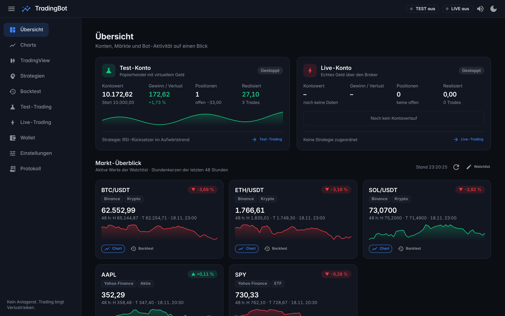
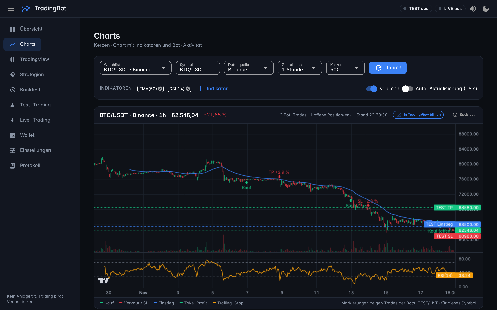
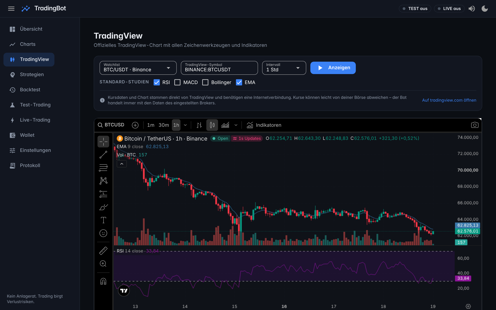
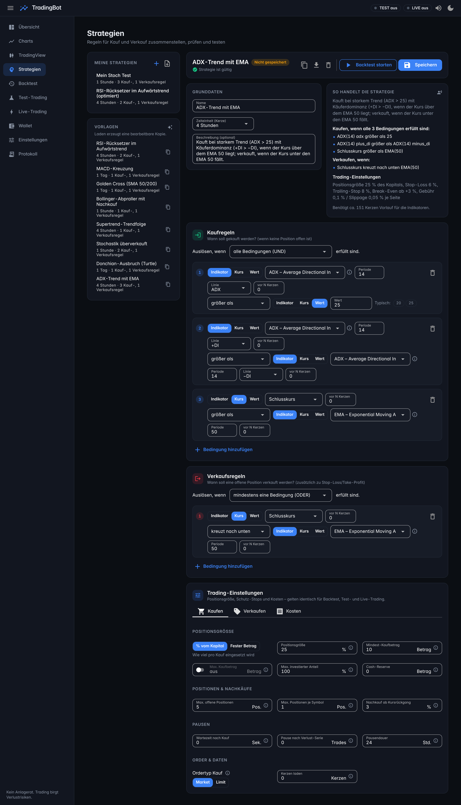
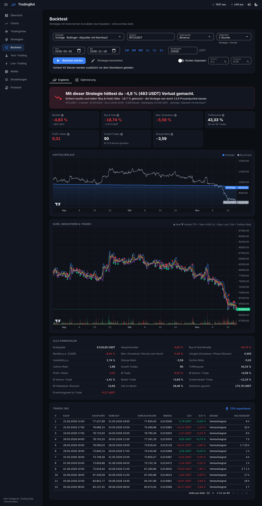
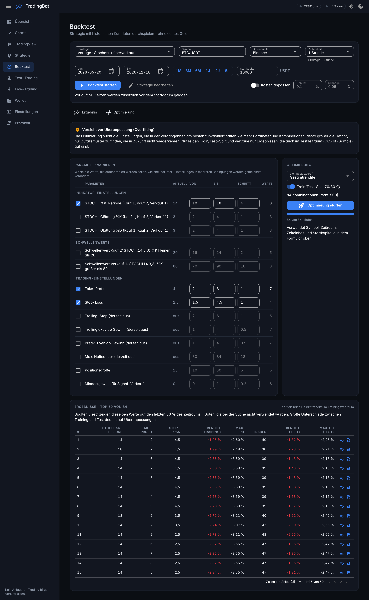
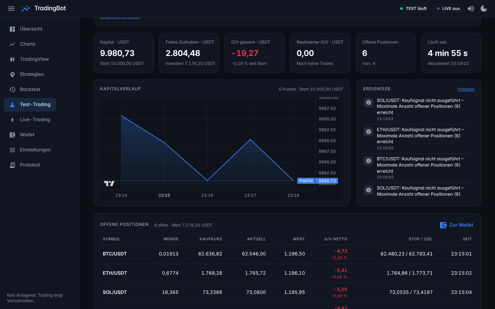
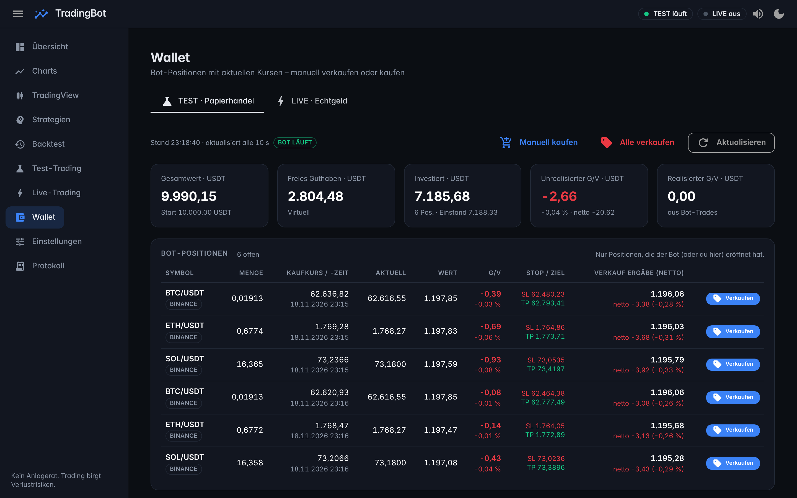
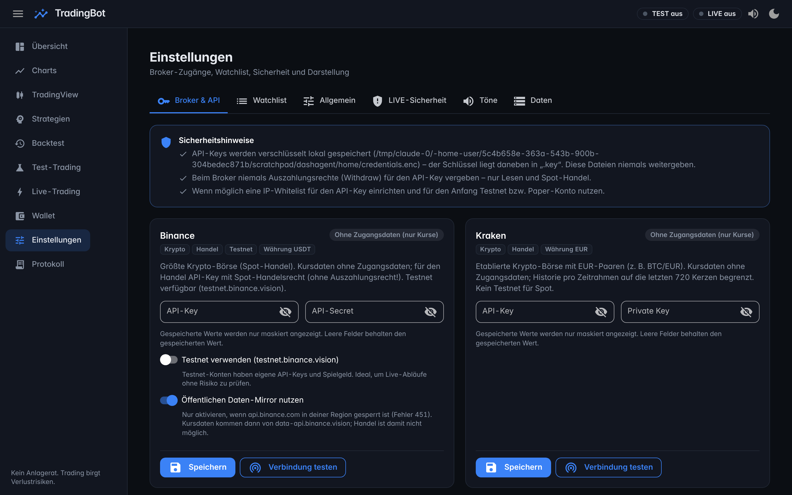

# TradingBot

Ein Trading-Bot in Python mit eigener Oberfläche. Er beobachtet Kryptowährungen, Aktien und ETFs, berechnet technische Indikatoren und kauft bzw. verkauft nach deinen Regeln. Es gibt drei Betriebsarten:

| Modus | Was passiert | Geld |
|---|---|---|
| **Backtest** | Die Strategie wird auf historischen Kursen durchgespielt. Ergebnis: Hättest du Gewinn gemacht? | keins |
| **TEST** | Der Bot läuft mit **echten Live-Kursen**, kauft und verkauft aber nur mit **virtuellem Guthaben**. Beim Broker wird nichts gekauft. | virtuell |
| **LIVE** | Der Bot handelt mit **echtem Geld** über die Broker-API. Standardmäßig gesperrt. | echt |

Backtest, TEST und LIVE verwenden **denselben Code** für Signale, Positionsgrößen, Stop-Loss und Take-Profit. Was der Backtest zeigt, macht der Bot später genauso.

> ⚠️ **Kein Anlagerat.** Trading birgt erhebliche Verlustrisiken. Ein Backtest-Gewinn bedeutet nicht, dass die Strategie in Zukunft funktioniert. Teste jede Strategie lange im TEST-Modus, bevor du echtes Geld einsetzt, und setze nur Geld ein, dessen Verlust du verkraften kannst.



---

## Funktionen

- **Broker-Abstraktion:** Binance und Kraken (Krypto, über `ccxt`), Alpaca (US-Aktien/ETFs), Yahoo Finance (nur Kursdaten, für Backtest und TEST mit Aktien/ETFs wie `SAP.DE`, `VWCE.DE`, `SPY`). Weitere Börsen lassen sich leicht ergänzen.
- **50 Indikatoren** in fünf Kategorien: Trend (SMA, EMA, HMA, KAMA, MACD, ADX, Ichimoku, Supertrend, Parabolic SAR …), Momentum (RSI, Stochastik, Stoch-RSI, CCI, Williams %R, MFI, TSI …), Volatilität (Bollinger, Keltner, Donchian, ATR …), Volumen (OBV, CMF, VWAP …) und Sonstige.
- **Strategie-Editor ohne Programmieren:** Kauf- und Verkaufsregeln wie „RSI(14) kleiner als 30 **und** Kurs größer als EMA(200)“. Logik „alle“, „mindestens eine“ oder „mindestens x %“ der Bedingungen. Dazu 8 Vorlagen.
- **Umfangreiche Trading-Einstellungen** (siehe unten), zum Beispiel Positionsgröße, Mindest-/Maximal-Kaufbetrag, Nachkäufe, Cooldown, Pause nach Verlust-Serie, Take-Profit, Stop-Loss, Trailing-Stop, Break-Even und Mindestgewinn.
- **Backtest** mit Gebühren und Slippage, Kennzahlen (Rendite, Buy & Hold, Max. Drawdown, Sharpe, Trefferquote, Profit-Faktor …), Equity-Kurve, Chart mit Kauf-/Verkaufsmarkern und Trade-Liste.
- **Parameter-Optimierung** mit Train/Test-Split zum Erkennen von Überanpassung.
- **Charts:** eigener Chart-Viewer (TradingView Lightweight Charts™) mit frei kombinierbaren Indikatoren und den Trades des Bots. Dazu das eingebettete **TradingView-Widget** mit allen Zeichenwerkzeugen.
- **Wallet:** alle offenen Positionen mit Kaufkurs, aktuellem Kurs, Gewinn/Verlust und dem Netto-Erlös eines Verkaufs (nach Gebühren). Verkaufen per Klick.
- **Töne** für Kauf, Verkauf mit Gewinn/Verlust, Take-Profit, Stop-Loss und Fehler, einzeln abschaltbar.
- **Sicherheit:** API-Schlüssel verschlüsselt gespeichert, LIVE-Hauptschalter, harte Obergrenze pro Order, tägliches Verlustlimit (Notbremse).

## Screenshots

| | |
|---|---|
| **Charts** mit Indikatoren und Bot-Trades  | **TradingView-Widget**  |
| **Strategie-Editor**  | **Backtest**  |
| **Optimierung**  | **Test-Trading**  |
| **Wallet**  | **Einstellungen**  |

## Installation (Windows)

### Variante A: fertige .exe (kein Python nötig)

Die .exe wird bei jedem Push automatisch von GitHub Actions gebaut:

1. Im Repo auf **Actions** → **Build Windows EXE** gehen und den neuesten erfolgreichen Lauf (grüner Haken) öffnen.
2. Unten bei **Artifacts** `TradingBot-windows` herunterladen und entpacken.
3. `TradingBot.exe` starten. Alternativ `TradingBot-folder.zip` entpacken und darin `TradingBot-folder.exe` starten. Die Ordner-Variante startet schneller und löst seltener Virenscanner-Fehlalarme aus.

Versionen mit Tag (z. B. `v1.0.0`) erscheinen zusätzlich dauerhaft unter **Releases**.

> Windows SmartScreen meldet unsignierte Programme manchmal als „unbekannt“. Dann über *Weitere Informationen → Trotzdem ausführen* starten.

### Variante B: aus dem Quellcode

Voraussetzung: Python 3.12 oder 3.13 (bei der Installation „Add to PATH“ anhaken).

```bash
git clone https://github.com/philip0908ffm/TradingBot.git
```

```bash
cd TradingBot
```

```bash
python -m venv .venv
```

```bash
.venv\Scripts\activate
```

```bash
pip install -r requirements.txt
```

```bash
python main.py
```

Die App öffnet sich im Browser unter http://localhost:8080. Mit `python main.py --native` öffnet sie sich als eigenes Fenster (vorher `pip install pywebview`).

### Selbst eine .exe bauen

```bash
pip install pyinstaller pywebview
```

```bash
nicegui-pack --onefile --windowed --name TradingBot --add-data "tradebot/gui;tradebot/gui" main.py
```

Ergebnis: `dist\TradingBot.exe`.

## Erste Schritte

1. **Einstellungen → Watchlist:** Symbole hinzufügen, die beobachtet werden sollen, z. B. `BTC/USDT` (Binance), `AAPL` oder `SAP.DE` (Yahoo).
2. **Strategien:** eine Vorlage öffnen oder eine eigene Strategie bauen und speichern.
3. **Backtest:** Strategie, Symbol und Zeitraum wählen und prüfen, ob sie Gewinn gemacht hätte. Wichtig ist der Vergleich mit Buy & Hold.
4. **Test-Trading:** Die Strategie mit echten Kursen und virtuellem Geld laufen lassen, am besten mehrere Wochen.
5. **LIVE (optional):** API-Schlüssel unter **Einstellungen → Broker & API** eintragen und testen. Danach unter **LIVE-Sicherheit** Limits setzen und den Hauptschalter aktivieren.

### API-Schlüssel richtig anlegen (Binance)

- In Binance unter *API Management* einen Schlüssel anlegen.
- **Nur „Lesen“ und „Spot-Trading“ erlauben, niemals „Auszahlungen“.**
- Möglichst eine **IP-Whitelist** setzen.
- Zum gefahrlosen Ausprobieren gibt es das **Binance Spot Testnet** (testnet.binance.vision): eigene Testnet-Schlüssel anlegen und in den Einstellungen „Testnet verwenden“ aktivieren.

Die Schlüssel werden verschlüsselt in deinem Benutzerordner gespeichert (`%USERPROFILE%\.tradebot\credentials.enc`), nie im Projektordner und nie im Git-Repo.

## Trading-Einstellungen

Jede Strategie hat eigene Trading-Einstellungen. Sie gelten im Backtest, im TEST- und im LIVE-Modus identisch.

**Kaufen**

| Einstellung | Bedeutung |
|---|---|
| Positionsgröße (% oder fester Betrag) | Wie viel pro Kauf eingesetzt wird |
| Mindest-Kaufbetrag | Kleinere Käufe werden ausgelassen |
| Maximaler Kaufbetrag | Obergrenze pro Kauf |
| Mindest-Signalstärke | Bei Logik „Mindestanteil“: so viel % der Kaufbedingungen müssen erfüllt sein |
| Max. offene Positionen (gesamt) | |
| Max. Positionen pro Symbol | > 1 erlaubt Nachkäufe … |
| Nachkauf erst ab −x % | … aber nur, wenn der Kurs x % unter dem letzten Kauf liegt |
| Cooldown (Sekunden) | Wartezeit nach einem Kauf, bevor dasselbe Symbol erneut gekauft wird |
| Max. Verlust-Serie + Pausendauer | Nach n Verlusten in Folge wird das Symbol pausiert |
| Max. investierter Anteil | z. B. höchstens 80 % des Kapitals gleichzeitig investiert |
| Cash-Reserve | Dieser Betrag wird nie verwendet |
| Kerzen laden | Wie viele Kerzen der Bot lädt (0 = automatisch) |
| Ordertyp + Preisfaktor | Market oder Limit, z. B. Limit zu Kurs × 1,001 |

**Verkaufen**

| Einstellung | Bedeutung |
|---|---|
| Take-Profit % | Verkauf bei +x % |
| Stop-Loss % | Verkauf bei −x % |
| Trailing-Stop % + Aktivierung | Stop läuft x % unter dem Höchstkurs mit, optional erst ab +y % |
| Break-Even ab +x % | Stop wird auf den Kaufkurs gezogen |
| Mindestgewinn (% / Betrag) | Verkaufssignale greifen erst ab diesem Gewinn (Stops greifen immer) |
| Max. Haltedauer | Verkauf nach x Kerzen |
| Ordertyp + Preisfaktor | z. B. Limit zu Kurs × 0,999 |

**Kosten:** Gebühr % und Slippage % pro Seite. Sie werden im Backtest und TEST-Modus simuliert.

**Globale LIVE-Sicherheit** (Einstellungen): Hauptschalter, harte Obergrenze pro Order, tägliches Verlustlimit mit Notbremse, max. offene Positionen.

## So rechnet der Backtest

- Signale werden auf **abgeschlossenen Kerzen** ausgewertet. Die Order wird zum **Eröffnungskurs der nächsten Kerze** ausgeführt, damit der Backtest keine zukünftigen Kurse verwendet.
- Gebühr und Slippage werden bei jedem Kauf und Verkauf abgezogen.
- Stop-Loss und Take-Profit werden innerhalb jeder Kerze über Hoch und Tief geprüft. Treffen beide in derselben Kerze, wird vorsichtig der Stop-Loss angenommen. Bei Kurslücken wird zum Eröffnungskurs ausgeführt.
- Zum Vergleich wird immer **Buy & Hold** berechnet. Eine Strategie, die Buy & Hold nicht schlägt, lohnt sich meist nicht.
- Warnung vor Überanpassung: Wenn du Parameter so lange optimierst, bis der Backtest gut aussieht, passt die Strategie oft nur auf die Vergangenheit. Nutze deshalb den Train/Test-Split der Optimierung.

## Daten & Dateien

Alles liegt in `%USERPROFILE%\.tradebot` (bzw. `~/.tradebot`). Ein anderer Ort lässt sich über die Umgebungsvariable `TRADEBOT_HOME` festlegen.

| Pfad | Inhalt |
|---|---|
| `settings.json` | Einstellungen, Watchlist |
| `credentials.enc` + `.key` | verschlüsselte API-Schlüssel |
| `strategies/` | gespeicherte Strategien (JSON) |
| `state/` | Journal des TEST- und LIVE-Bots, virtuelles Konto |
| `cache/` | zwischengespeicherte Kursdaten |
| `logs/tradebot.log` | Protokoll |

## Projektstruktur

```
main.py                 Start (GUI, --native, --selftest)
tradebot/
  core/                 Datenmodelle, Einstellungen, Logging
  brokers/              Broker-Abstraktion: Binance, Kraken, Alpaca, Yahoo, Paper (TEST), Kurs-Cache
  indicators/           50 Indikatoren (reines pandas/numpy) + Registry
  strategy/             Strategie-Modell, Signal-Engine, Trading-Regeln (risk.py), Vorlagen
  backtest/             Backtest-Engine, Kennzahlen, Optimierung
  engine/               Trading-Bot (TEST/LIVE), Journal, Bot-Manager
  gui/                  Oberfläche (NiceGUI), Chart-Komponente, Seiten
tests/                  automatische Tests (pytest)
```

Tests ausführen:

```bash
python -m pytest -q
```

Eigenen Broker ergänzen: eine Klasse von `tradebot.brokers.base.Broker` ableiten (Kursdaten, Kontostand, Orders) und in `tradebot/brokers/__init__.py` in `BROKERS` eintragen.

## Lizenzhinweise

Der Chart-Viewer nutzt **TradingView Lightweight Charts™** (Apache-2.0, © TradingView, Inc., siehe `tradebot/gui/vendor/lwc/LICENSE`). Das eingebettete Widget auf der Seite „TradingView“ ist ein kostenloses Widget von [TradingView](https://www.tradingview.com/) und benötigt eine Internetverbindung.
